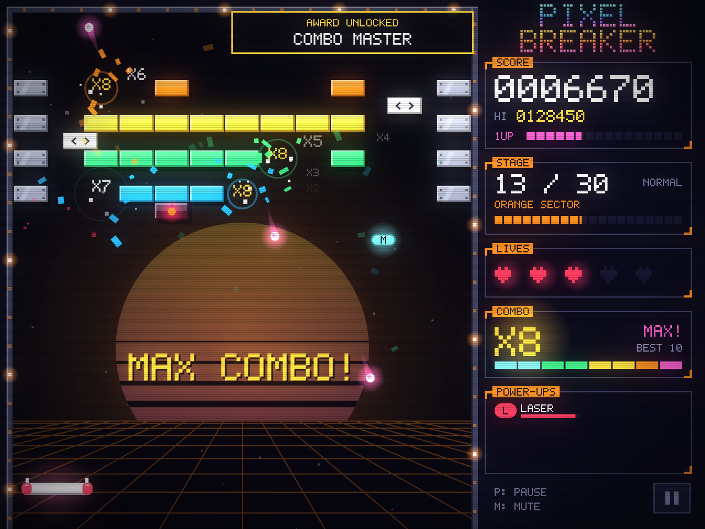
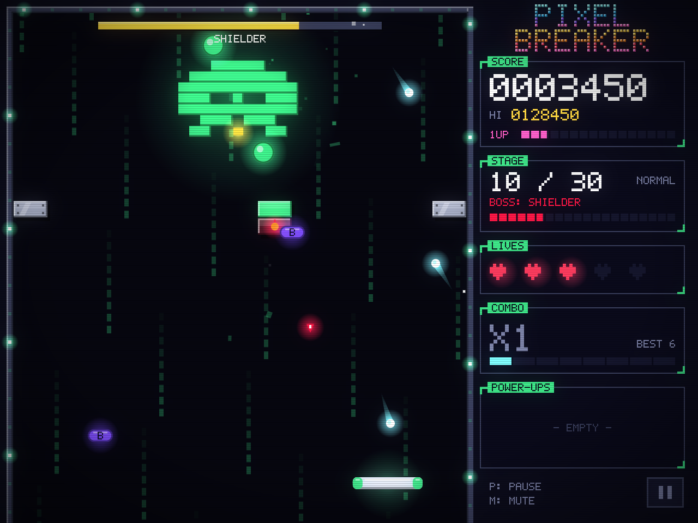
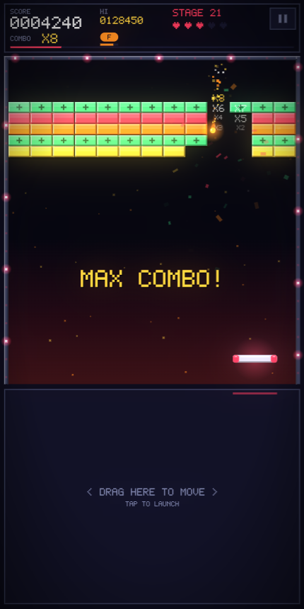

<p align="center">
  <a href="https://jihunyangai.github.io/pixel-breaker/">
    
  </a>
</p>

<h3 align="center">🕹️ INSERT COIN ▶ <a href="https://jihunyangai.github.io/pixel-breaker/">PLAY NOW</a></h3>

<p align="center">
  레트로 감성, 고해상도 화질의 벽돌깨기.<br>
  설치 없이 PC와 모바일 브라우저에서 바로 플레이.
</p>

```
╔══════════════════════════════════════════════════════════╗
║  1UP  0128450        HI-SCORE  0128450        STAGE 14   ║
║  ♥ ♥ ♥               COMBO  x8  MAX!          ▓▓▓▓▓▓░░░  ║
╚══════════════════════════════════════════════════════════╝
```

<p align="center">
  
  
</p>

---

## ▶ PLAYER 1 START

| | 🖥️ PC | 📱 MOBILE |
|---|---|---|
| **MOVE** | 마우스 또는 `←` `→` / `A` `D` | 화면을 좌우로 끌기 |
| **FIRE** | 클릭 또는 `SPACE` | 짧게 탭 (레이저는 누르고 있기) |
| **PAUSE** | `P` 또는 `ESC` | 화면의 ⏸ 버튼 |
| **MUTE** | `M` | 옵션에서 볼륨 조절 |

> 💡 **TIP** 패들의 어디에 맞히느냐로 공의 각도가 정해진다. 가장자리일수록 크게 꺾인다.

## 🎮 SELECT MODE

| MODE | 규칙 |
|---|---|
| **ARCADE** | 30 스테이지, 6개 월드. 5스테이지마다 보스. 깬 월드부터 이어하기 |
| **ENDLESS** | 벽돌 줄이 끝없이 내려온다. 빨간 선에 닿으면 GAME OVER |
| **DAILY** | 날짜마다 바뀌는 5 스테이지. 같은 날은 모두 같은 배치 |

난이도 `EASY` / `NORMAL` / `HARD` — HARD는 점수 x1.5

## 🧱 BRICKS

| | 벽돌 | 특징 |
|---|---|---|
| 🟥 | **NORMAL** | 한 방 |
| 🟦 | **HARD** | 2~3번 맞아야 부서진다. 맞을 때마다 금이 간다 |
| ⬜ | **STEEL** | 부서지지 않는다 (파이어볼만 예외) |
| 💣 | **BOMB** | 터지면서 주변을 연쇄로 날린다 |
| 👻 | **GHOST** | 2초마다 사라졌다 나타난다. 사라진 동안은 통과 |
| ↔️ | **MOVER** | 좌우로 움직인다 |
| ➕ | **REGEN** | 부숴도 8초 뒤 되살아난다 |
| 💎 | **TREASURE** | 파워업을 반드시 떨어뜨린다 |

## ⚡ POWER-UPS

| 캡슐 | 이름 | 효과 |
|:---:|---|---|
| `E` | **EXPAND** | 패들 확대 |
| `M` | **MULTI** | 공이 3개로 분열 |
| `L` | **LASER** | 패들에서 레이저 발사 |
| `F` | **FIRE** | 벽돌을 관통하는 파이어볼 |
| `C` | **CATCH** | 공을 붙잡았다가 원할 때 발사 |
| `S` | **SLOW** | 공 감속 |
| `B` | **BARRIER** | 바닥 보호막 1회 |
| `♥` | **1UP** | 목숨 +1 |

**⚠️ DANGER** 빨갛게 깜빡이는 캡슐은 함정이다 — `T` 패들 축소 · `X` 공 가속 · `R` 좌우 반전.<br>
그래도 일부러 받으면 **+500점**.

## 🔥 COMBO

공이 패들에 닿기 전까지 벽돌을 연달아 부수면 점수 배율이 오른다.

```
x1 ▸ x2 ▸ x3 ▸ x4 ▸ x5 GREAT! ▸ x6 ▸ x7 ▸ x8 MAX COMBO!
```

## 👾 BOSS RUSH

| WORLD | BOSS | 기믹 |
|:---:|---|---|
| 1 | **GUARDIAN** | 기본기 시험 |
| 2 | **SHIELDER** | 공을 튕겨 내는 방패 구슬이 돈다 |
| 3 | **TRICKSTER** | 가짜 분신이 섞여 있다 |
| 4 | **MASON** | 벽돌 벽을 계속 다시 쌓는다 |
| 5 | **DEVOURER** | 입을 벌렸을 때 맞으면 공을 삼켰다 뱉는다 |
| 6 | **OVERLORD** | 전부 다 한다 |

아래쪽 가운데의 코어를 맞히면 **CRITICAL** — 피해 2배.

## 📱 MOBILE

<p align="center">
  
</p>

세로 화면에서는 필드 아래가 터치 조작 공간이 된다. 손가락이 공을 가리지 않는다.

## 🏆 HIGH SCORES

```
 RANK   NAME   SCORE
 1ST    ???    0000000   ◀ YOUR NAME HERE
 2ND    ---    -------
 3RD    ---    -------
```

기록은 브라우저에 저장된다. 업적 12개도 함께.

---

## 🔧 RUN LOCALLY

Node.js가 필요하다.

- **Windows** — `PLAY.bat` 더블클릭
- **터미널** — `npm start` 후 `http://localhost:5173`

`index.html`을 직접 열면 실행되지 않는다 (ES 모듈은 `file://`에서 막힌다).

## 🛠️ UNDER THE HOOD

- 순수 JavaScript + Canvas 2D. 프레임워크·빌드 도구 없음
- 이미지·음원 파일 없음. 그래픽은 코드로 그리고, 칩튠은 Web Audio로 실시간 합성
- 120Hz 고정 물리 + 보간 렌더. 모니터 원본 해상도(4K·고DPI)로 그린다
- 기획과 기술 설계는 [design.md](design.md)

<p align="center"><b>GAME OVER?&nbsp; CONTINUE ▶ 9 8 7 6 5 …</b></p>
